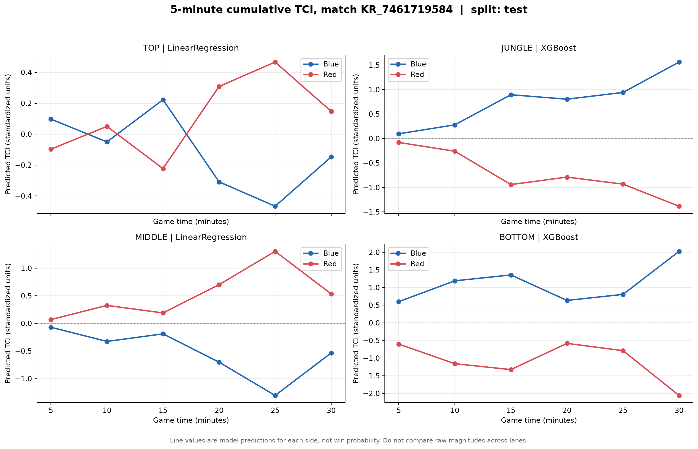
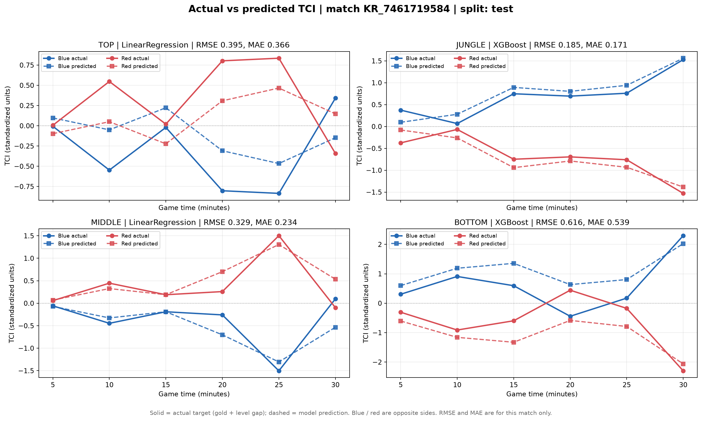

# LoL 라인별 TCI: 5분 단위 경기 우위 분석 및 소환사 평가

> **프로젝트 상태:** 전체 데이터 기반 실험 및 시각화 완료 · 2026년 12월 8일 발표 준비
>
> **핵심 질문:** 승리한 팀만 평가하는 대신, 경기 도중 각 라인이 상대보다 얼마나 앞서거나 뒤처졌는지 수치로 설명할 수 있을까?

## 1. 프로젝트 개요

### 1.1 연구 목적

리그 오브 레전드(LoL)의 최종 승패만으로는 경기 중 각 포지션이 어떤 우위를 확보했는지 파악하기 어렵다. 본 프로젝트에서는 **TCI(Timeline Contribution Index)**를 정의하여 5분 단위 누적 경기 기록으로부터 **상대 라인 대비 골드·레벨 우위**를 추정하고, 그 변화를 그래프로 표현한다.

TCI는 공식 Riot 지표가 아니라 **본 프로젝트에서 정의한 모델 기반 상대적 우위 지표**이다. TCI가 높다고 해서 플레이어의 절대적인 실력이나 경기 승리 확률이 높다고 직접 해석해서는 안 된다.

### 1.2 데이터와 분석 범위

- **원천 자료:** Riot Games Match-V5 경기 및 타임라인 JSON
- **정상 처리:** 38,075경기, 제외 0경기
- **분석 포지션:** TOP, JUNGLE, MIDDLE, BOTTOM(ADC+SUPPORT 듀오)
- **시간 축:** 경기 시작 후 5, 10, 15, 20분 등 5분 간격의 **누적** 값(서로 독립적인 5분 구간이 아님)
- **생성 데이터:** 라인별 390,800행, 4개 라인 합계 1,563,200행
- **분할 원칙:** 같은 경기의 여러 시점과 양 팀 기록이 학습/검증/테스트에 동시에 들어가지 않도록 `matchId`로 분할

| 데이터 구분 | 경기 수 | 라인별 행 수 |
|---|---:|---:|
| 학습(Train) | 26,653 | 273,580 |
| 검증(Validation) | 5,711 | 58,578 |
| 테스트(Test) | 5,711 | 58,642 |
| **합계** | **38,075** | **390,800** |

각 경기와 시점에서 블루/레드 양측을 포함하므로, 데이터 행 수는 경기 수와 다르다. 위 분할 비율은 경기 수를 기준으로 약 70/15/15%이다.

### 1.3 연구 진행 과정

1. 경기 JSON과 타임라인 JSON을 대응시켜 누적 경기 기록 추출
2. 라인별 입력 변수(X)와 지도학습 목표값(y) 설계
3. 골드 격차·레벨 격차·결합 지표의 승패 관련성 비교
4. 선형회귀·Ridge·Random Forest·XGBoost 학습 및 검증
5. 테스트 데이터 평가와 피처 중요도 분석
6. 개별 경기의 시간별 TCI 및 소환사/듀오별 평균 TCI 활용

## 2. 변수 설계

### 2.1 타겟(y): 골드 격차와 레벨 격차 결합

경제적 우위만 측정하는 골드 격차와 성장 단계 차이를 나타내는 레벨 격차를 함께 고려했다.

\[
TCI_{target} = 0.5\times \frac{GoldGap}{\sigma_{GoldGap,train}}
             + 0.5\times \frac{LevelGap}{\sigma_{LevelGap,train}}
\]

여기서 `GoldGap`과 `LevelGap`은 해당 시점에 자신의 라인/듀오가 상대보다 앞선 정도이며, 분모는 **학습 데이터에서 계산한 표준편차**다. 서로 단위가 다른 골드와 레벨을 비슷한 크기로 맞추기 위한 정규화로, 테스트 데이터의 정보가 학습에 들어가지 않도록 학습 데이터의 기준을 사용했다. 이 계산은 일반적인 평균 제거 z-score와 달리 **평균을 빼지 않고 표준편차로 나누는 형태**이므로 구두 설명에서도 구분한다.

이 지표는 회귀모델이 학습할 **정답에 해당하는 목표값**이다. 모델의 TCI 예측값은 이 목표값을 입력 변수로 추정한 값이다.

### 2.2 왜 골드+레벨인가? 승패와의 관련성 검증

전체 38,075경기를 경기 ID로 학습/검증/테스트로 나누고, 골드 격차 단독·레벨 격차 단독·두 지표 결합을 이용해 최종 승패 예측 성능을 비교했다. 이는 **타겟 선정의 보조 근거**이며, TCI 회귀모델 자체의 승패 예측 정확도를 뜻하지 않는다.

**20분 시점 테스트 정확도 (각 라인에서 n=5,711경기)**

| 라인 | 골드 격차 | 레벨 격차 | 골드+레벨 격차 |
|---|---:|---:|---:|
| TOP | 61.7% | 61.1% | **62.2%** |
| JUNGLE | 67.6% | 67.7% | **69.5%** |
| MIDDLE | 64.3% | 62.1% | **64.9%** |
| BOTTOM | 68.0% | 68.0% | **69.5%** |

**20분 시점 테스트 ROC-AUC**

| 라인 | 골드 격차 | 레벨 격차 | 골드+레벨 격차 |
|---|---:|---:|---:|
| TOP | 0.6752 | 0.6705 | **0.6862** |
| JUNGLE | 0.7407 | 0.7532 | **0.7679** |
| MIDDLE | 0.6948 | 0.6682 | **0.7010** |
| BOTTOM | 0.7499 | 0.7421 | **0.7697** |

20분 시점에는 결합 지표가 네 라인 모두에서 가장 높은 테스트 정확도와 ROC-AUC를 나타냈다. **그러나 5~15분의 모든 시점에서 결합 지표가 가장 좋은 것은 아니었으며**, 성능 차이에 대한 통계적 유의성 검정은 수행하지 않았다. 따라서 “결합 지표가 언제나 우수하다”가 아니라 **“20분 시점의 성능 개선이 관찰되었다”**로 해석한다.

### 2.3 입력 변수(X): 경기 도중 관측 가능한 정보

CS(미니언·정글 자원), 킬, 데스, 어시스트, 챔피언 대상 피해량, 받은 피해량, 포탑 파괴 및 관여 정보 등을 경기 시점별로 누적하여 사용한다. 정글에는 드래곤·전령 등 주요 오브젝트 관련 피처도 고려한다. BOTTOM은 ADC와 SUPPORT를 하나의 듀오로 묶어 상대 듀오와 비교한다.

- **입력에 포함하지 않는 정보:** 정답에 직접 사용한 골드·레벨 및 이를 단순히 재구성하는 변수. 실제 구현에서는 모델의 `features` 목록으로 사용 컬럼을 확인한다.
- **미래 정보 금지:** 10분 예측에 경기 종료 후에야 알 수 있는 수치(최종 포탑 피해량 등)를 넣지 않는다.
- **누적값 구분:** 15분 피처는 10~15분만이 아니라 경기 시작부터 15분까지의 누적 상황을 나타낸다.

> 피처의 **정확한 최종 전체 컬럼 목록**과 선택/제외 과정은 `train_tci_models.py`에서 저장한 모델 번들의 `features` 항목으로 검증하여 발표 전에 확정한다.

## 3. 모델링 및 성능 평가

### 3.1 비교 모델과 작동 원리

| 모델 | 어떻게 작동하는가? | LoL 데이터 적용 관점 |
|---|---|---|
| **Linear Regression(선형회귀)** | CS·킬·데스 등에 각각 가중치를 곱해 더하여 TCI를 예측한다. 예: `예측값 = a×CS격차 + b×킬격차 + …` | 누적 경제·성장 차이를 비교적 단순한 관계로 설명할 때 유리하며 해석이 쉽다. |
| **Ridge** | 선형회귀와 같지만 가중치가 지나치게 커지는 것을 벌점으로 억제한다. | 서로 관련이 큰 경기 지표가 여럿 있을 때 안정성을 높이기 위한 비교 모델이다. |
| **Random Forest** | 여러 의사결정나무가 서로 다른 자료를 학습하고 예측값을 평균 낸다. | 킬·CS·오브젝트의 복합적 조건을 반영할 수 있다. |
| **XGBoost** | 의사결정나무를 순서대로 추가하면서 이전 예측에서 남은 오차를 줄인다. | 라인전 상황과 누적 자원 지표 사이의 비선형적 조합을 반영할 수 있다. |

이 모델들이 LoL에서 *반드시* 우월하다는 가정으로 선정한 것이 아니다. **동일한 검증 데이터에서 오차를 비교한 다음 라인별로 선택**했다.

### 3.2 모델 평가 지표

- **MAE:** 예측값과 실제값 사이 오차 절댓값의 평균. 직관적인 평균 오차 크기.
- **RMSE:** 큰 오차에 더 큰 불이익을 주는 지표. **낮을수록 좋음**.
- **R²:** 전체 타겟 변동을 모델이 얼마나 설명하는지 나타내는 지표. **승률 또는 승패 예측 정확도가 아님**.

모델 선택은 **검증(Validation) RMSE** 기준으로 수행했으며, 테스트 성능은 선택이 끝난 후 별도로 확인했다.

### 3.3 전체 38,075경기 학습 결과

| 라인 | 선정 모델 | Train RMSE | Val RMSE | Test RMSE | Test MAE | Test R² |
|---|---|---:|---:|---:|---:|---:|
| TOP | **Linear Regression** | 0.3622 | 0.3664 | 0.3564 | 0.2705 | 0.8512 |
| JUNGLE | **XGBoost** | 0.3338 | 0.3343 | 0.3361 | 0.2557 | 0.8658 |
| MIDDLE | **Linear Regression** | 0.3915 | 0.3838 | 0.3917 | 0.2922 | 0.8122 |
| BOTTOM | **XGBoost** | 0.4091 | 0.4084 | 0.4102 | 0.3108 | 0.7985 |

**검증 RMSE 비교(선택 근거)**

| 라인 | Linear Regression | Ridge | Random Forest | XGBoost |
|---|---:|---:|---:|---:|
| TOP | **0.3664** | 0.3664 | 0.3929 | 0.3669 |
| JUNGLE | 0.3346 | 0.3346 | 0.3593 | **0.3343** |
| MIDDLE | **0.3838** | 0.3838 | 0.4140 | 0.3870 |
| BOTTOM | 0.4086 | 0.4086 | 0.4226 | **0.4084** |

선형회귀가 TOP·MIDDLE에서, XGBoost가 JUNGLE·BOTTOM에서 가장 좋은(또는 출력 정밀도상 동률인) 검증 성능을 보였다. **특히 JUNGLE과 BOTTOM의 모델 간 차이는 매우 작으므로 XGBoost의 명확한 우월성을 주장할 수 없다.**

### 3.4 피처 중요도

검증 데이터에서 입력 피처를 섞었을 때 RMSE가 얼마나 증가하는지 확인하는 *Permutation Importance*를 사용했다. 증가량이 클수록 **해당 모델이 예측에 더 의존한 피처**라는 의미이지, 그 피처가 승패를 직접 유발한다는 뜻은 아니다.

| 라인 | 모델 | 가장 중요하게 나타난 피처 | 검증 RMSE 증가량 |
|---|---|---|---:|
| TOP | Linear Regression | CS | +0.3393 |
| JUNGLE | XGBoost | CS | +0.4252 |
| MIDDLE | Linear Regression | CS | +0.3615 |
| BOTTOM | XGBoost | Kills | +0.2565 |

## 4. TCI 활용 사례

### 4.1 실제 경기의 5분 간격 우위 변화

테스트 경기 **`KR_7461719584`**에서 라인별 블루/레드 TCI의 변화를 분석했다.



- **TOP:** 20분 이후 레드 측이 우세한 구간이 나타남.
- **JUNGLE:** 전 시점에 걸쳐 블루 측 우위가 유지됨.
- **MIDDLE:** 전반적으로 레드 측 우위가 나타남.
- **BOTTOM:** ADC·SUPPORT 듀오 단위에서 블루 측이 지속적으로 우세함.

이 결과는 **팀의 최종 승패와 각 라인의 시간별 우위가 다른 문제**임을 보여준다. 라인별 모델의 점수 척도가 완전히 동일하다고 보장되지 않으므로 TOP의 `+1`과 JUNGLE의 `+1`을 같은 절대 성과로 비교하지 않는다.

### 4.2 실제 타겟과 모델 예측 비교



이 그래프에서 **실선은 실제 타겟(골드+레벨 격차), 점선은 회귀모델 예측값**이다.

| 라인 | 해당 경기 RMSE | 해당 경기 MAE |
|---|---:|---:|
| TOP | 0.395 | 0.366 |
| JUNGLE | **0.185** | **0.171** |
| MIDDLE | 0.329 | 0.234 |
| BOTTOM | 0.616 | 0.539 |

이 **한 경기**에서는 JUNGLE의 오차가 작고 BOTTOM의 오차가 컸다. TOP과 BOTTOM에서는 실제 우위가 바뀌는 일부 시점을 예측이 따라가지 못했다. **전체 성능은 3.3절의 테스트 5,711경기 결과로 평가**해야 한다.

### 4.3 소환사별 평균 TCI 활용

각 경기의 마지막으로 관측 가능한 5분 체크포인트에서 예측 TCI를 하나씩 뽑아, 소환사별 최근 최대 20경기의 평균을 계산했다. 평가 표본은 최소 5경기를 기준으로 제한했다. BOTTOM은 개인이 아닌 **동일 ADC+SUPPORT 듀오**가 하나의 평가 대상이다.

**전체 분할 포함(`--split all`) 결과**

| 라인 | 평가 대상 수 | 5경기 이상 |
|---|---:|---:|
| TOP | 7,592명 | 1,998명 |
| JUNGLE | 6,510명 | 1,829명 |
| MIDDLE | 7,783명 | 2,058명 |
| BOTTOM | 66,914개 듀오 | 279개 듀오 |

**보지 않은 경기만 사용(`--split test`)한 진단 결과**

| 라인 | 평가 대상 수 | 5경기 이상 | 해석 |
|---|---:|---:|---|
| TOP | 2,927명 | 557명 | 표본 수에 유의하여 등급 확인 |
| JUNGLE | 2,632명 | 569명 | 표본 수에 유의하여 등급 확인 |
| MIDDLE | 3,001명 | 542명 | 표본 수에 유의하여 등급 확인 |
| BOTTOM | 11,114개 듀오 | **2개 듀오** | 등급/백분위 산출 보류 |

**중요:** 훈련 경기까지 포함하는 `all` 순위는 모델의 독립적인 일반화 평가가 아닌 **활용 예시**다. 테스트만 사용한 순위도 소환사별 관측 경기 수가 적고 상대방 실력·챔피언·패치 환경의 영향을 받는다. TCI 순위나 S등급을 실제 게임 티어와 동일시해서는 안 된다.

### 4.4 실전 활용 가능성 및 한계

TCI를 이용하면 경기별로 ① 특정 라인의 상대적 우위가 어느 시점에 증가하거나 감소했는지, ② 모델이 실제 타겟과 얼마나 일치하는지, ③ 반복 관측된 소환사/듀오의 평균 우위가 어땠는지를 시각화할 수 있다. 향후에는 챔피언·상대 수준·패치별 보정을 적용하고, 시간대별 실제 게임 이벤트와 TCI 변화를 연결해 해석력을 높일 수 있다.

현재 모델의 한계는 다음과 같다.

1. **TCI의 의미:** 골드·레벨 우위에 기반한 예측값이므로 실력, 승리 확률, 인과적 기여도를 직접 측정하지 못한다.
2. **샘플 수:** 소환사별 5경기만으로 산출한 최상위 순위는 불안정할 수 있다.
3. **BOTTOM 듀오:** ADC와 SUPPORT의 개인별 기여를 분리할 수 없다.
4. **환경 변화:** 챔피언 구성·상대 수준·게임 패치 등의 차이를 충분히 보정하지 못할 수 있다.
5. **예측 누락:** 실제 경기 중 우위가 급격히 바뀌는 순간을 회귀모델이 완전히 추적하지 못할 수 있다.

## 5. 실행 방법과 결과 파일

### 5.1 프로젝트 구조

```text
lol_project/
├── match_data/                           # match_*.json, timeline_*.json (원본)
├── data_process_4lane_cumulative_v2.py
├── prepare_tci_targets_gold_level_v2.py
├── train_tci_models.py
├── validate_tci_target_win.py
├── analyze_tci_feature_importance.py
├── evaluate_tci_summoners.py
├── plot_tci_5min.py
├── datasets_5min_fixed/                  # 전처리된 5분 누적 데이터
├── tci_supervised/                       # train / val / test CSV
├── tci_model_results/                    # 학습 모델 및 성능
├── target_win_validation/                # 타겟 후보 비교 결과
├── tci_feature_importance/               # 중요도 CSV/PNG
├── tci_summoner_ranking/                 # 소환사/듀오별 TCI
└── tci_timeline_charts/                  # 시간별 그래프, 실제/예측 비교
```

### 5.2 실행 순서

아래 명령은 프로젝트 루트 폴더에서 실행한다. 필요한 라이브러리는 `pandas`, `numpy`, `scikit-learn`, `xgboost`, `matplotlib`, `joblib` 등이며, 세부 의존성과 버전은 별도로 고정해 재현성을 높인다.

```powershell
python data_process_4lane_cumulative_v2.py --data-dir match_data
python prepare_tci_targets_gold_level_v2.py --input-dir datasets_5min_fixed
python train_tci_models.py
python validate_tci_target_win.py --input-dir datasets_5min_fixed
python analyze_tci_feature_importance.py
python evaluate_tci_summoners.py --split all
python evaluate_tci_summoners.py --split test
python plot_tci_5min.py --match-id KR_7461719584
```

> **파일 덮어쓰기 주의:** 소환사 평가를 `--split all`, `--split test`로 연속 실행하면 같은 출력 폴더의 파일이 덮어써질 수 있다. 각 결과를 보관하려면 `--output-dir` 옵션이 지원되는지 확인하고 폴더를 분리하거나 실행 사이 결과 파일을 백업한다.
>
> **GitHub 업로드:** 수집한 대용량 원본 JSON·개인 식별성이 있는 데이터·큰 학습 산출물은 무조건 공개하지 않고 Riot API 및 데이터 이용 정책을 확인한다. 소스 코드, README, 발표용 비식별화된 집계 결과와 그래프를 중심으로 공개한다.

## 6. 발표 핵심 메시지

- **왜 만들었나:** 최종 승패만으로는 라인별 경기 흐름을 충분히 설명하기 어렵기 때문이다.
- **무엇을 예측하나:** 5분 시점까지의 기록으로 상대 라인 대비 **골드+레벨 우위**를 추정한다.
- **왜 모델이 다른가:** 각 라인의 검증 RMSE를 비교해 가장 낮은 모델을 골랐기 때문이다.
- **어떻게 쓰나:** 한 경기의 라인별 TCI 곡선을 보거나, 반복된 경기의 평균 TCI로 관측된 상대 우위를 요약한다.
- **무엇이 한계인가:** 절대 실력 등급, 기여도 인과관계, 승리 확률을 직접 뜻하지 않는다.

## 7. 참고 자료

1. [Riot Games Developer Portal](https://developer.riotgames.com/) — Match-V5 및 타임라인 데이터 출처
2. [scikit-learn LinearRegression](https://scikit-learn.org/stable/modules/generated/sklearn.linear_model.LinearRegression.html)
3. [scikit-learn Ridge](https://scikit-learn.org/stable/modules/generated/sklearn.linear_model.Ridge.html)
4. [scikit-learn RandomForestRegressor](https://scikit-learn.org/stable/modules/generated/sklearn.ensemble.RandomForestRegressor.html)
5. [scikit-learn permutation_importance](https://scikit-learn.org/stable/modules/generated/sklearn.inspection.permutation_importance.html)
6. [XGBoost Documentation](https://xgboost.readthedocs.io/)

---

**제출 전 최종 점검:** 그림 파일 2개를 README와 동일한 상대 경로에 배치하고, 코드의 실제 선택 피처 목록·학습 하이퍼파라미터·모델 번들 경로·사용 라이브러리 버전·실제 GitHub URL을 확인한다. 현재 README에 적힌 결과 수치는 프로젝트 실행 로그를 바탕으로 한 값이다.
